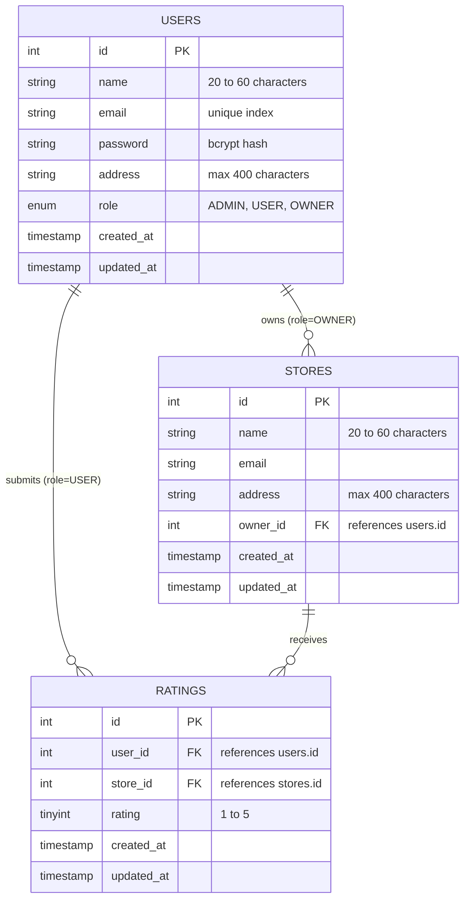

# 🌟 Store Rating Management System (Bangalore Edition)

[](https://nodejs.org/)
[](https://expressjs.com/)
[](https://react.dev/)
[](https://www.mysql.com/)
[](https://www.docker.com/)
[](https://opensource.org/licenses/ISC)

A production-grade, full-stack **Store Rating Management System** architected with clean separation of concerns, enterprise-grade security hardening, and real-time review aggregations. Built specifically with localized Indian entities and Bangalore (Bengaluru) localities.

---

## 📋 Table of Contents

- [System Architecture](#-system-architecture)
- [Role-Based Access Control (RBAC)](#-role-based-access-control-rbac)
- [Database Schema & Constraints](#-database-schema--constraints)
- [Security & Production Hardening](#-security--production-hardening)
- [Quick Start Guide (Local Development)](#-quick-start-guide-local-development)
- [Pre-Seeded Bangalore Test Accounts](#-pre-seeded-bangalore-test-accounts)
- [Production Deployment Strategies](#-production-deployment-strategies)
  - [Option A: Docker & Docker Compose (Recommended)](#option-a-docker--docker-compose-recommended)
  - [Option B: Single-Port Cloud Deployment (Render / Railway)](#option-b-single-port-cloud-deployment-render--railway)
  - [Option C: Production Ubuntu VPS (Nginx + PM2)](#option-c-production-ubuntu-vps-nginx--pm2)
- [Complete REST API Reference](#-complete-rest-api-reference)
- [Testing & Quality Assurance](#-testing--quality-assurance)

---

## 🏛️ System Architecture

```mermaid
graph TD
    Client["React 19 SPA (Vite / React Router DOM / Axios)"]
    Proxy["Nginx / Helmet / Rate Limiting Security Gateway"]
    API["Express 5.3 RESTful API Server"]
    Auth["JWT & Bcrypt Security Layer"]
    DB[("MySQL 8.0 (store_rating_db)")]

    Client -->|HTTPS / REST API| Proxy
    Proxy --> API
    API --> Auth
    API -->|Connection Pool (mysql2)| DB
```

The system is architected as an **MVC with Service Layer**:
* **Frontend:** Built with React 19, React Router DOM, Axios interceptors, Context API, and a custom CSS3 design system.
* **Backend:** Built on Node.js 22 and Express 5.3 with connection pooling, parameterized SQL queries, and centralized error handling.
* **Database:** Normalized MySQL 8.0 schema with strict foreign keys, indexes, and unique constraints.

---

## 👥 Role-Based Access Control (RBAC)

| Feature | System Administrator (ADMIN) | Store Owner (OWNER) | Normal User (USER) |
| :--- | :---: | :---: | :---: |
| **System Dashboard & Statistics** | ✅ Full System | ❌ | ❌ |
| **Manage / Add Users & Roles** | ✅ All Roles | ❌ | ❌ |
| **Manage / Add Stores** | ✅ All Stores | ❌ | ❌ |
| **View Audit Trails & All Reviews** | ✅ | ❌ | ❌ |
| **Store Dashboard & Live Average** | ✅ | ✅ (Own Store Only) | ❌ |
| **View Customers Who Rated Store** | ✅ | ✅ (Own Store Only) | ❌ |
| **Browse Stores & Search Locations** | ✅ | ❌ | ✅ |
| **Submit / Update 1-to-5 Star Rating**| ❌ | ❌ | ✅ (1 per store) |
| **Change Password** | ✅ | ✅ | ✅ |

---

## 🗄️ Database Schema & Constraints



### Strict Database Integrity Rules:
1. **Single Rating Per Store:** `UNIQUE KEY unique_user_store_rating (user_id, store_id)` prevents duplicate reviews.
2. **Rating Range:** Enforced database constraint `CHECK (rating >= 1 AND rating <= 5)`.
3. **Foreign Key Integrity:** Store deletion cascades to ratings (`ON DELETE CASCADE`), while deleting an owner with assigned stores is restricted (`ON DELETE RESTRICT`).
4. **Real-Time SQL Aggregations:** Average ratings are computed dynamically via SQL aggregation:
   ```sql
   ROUND(COALESCE(AVG(r.rating), 0), 1) AS average_rating,
   COUNT(r.id) AS total_ratings
   ```

---

## 🔒 Security & Production Hardening

* **Helmet HTTP Headers:** Sets HTTP Content-Security-Policy, X-Content-Type-Options, Frameguard, and HSTS.
* **Brute-Force Rate Limiting:** Enforces maximum 30 authentication attempts per 15 minutes on login/registration routes.
* **API Rate Limiting:** General API limiter capping requests at 300 requests per 15 minutes per IP.
* **Gzip/Brotli Compression:** Compresses all outbound responses for accelerated load times.
* **Payload Size Guards:** Body parser constrained to 100kb to mitigate memory-exhaustion denial-of-service.
* **Bcryptjs Salting:** Uses 10-round salted bcrypt hashing so plain-text passwords never enter persistence.
* **Graceful Termination:** Server listens to `SIGTERM` and `SIGINT`, halts incoming connections, drains the MySQL connection pool (`pool.end()`), and exits cleanly without dropping ongoing transactions.

---

## 🚀 Quick Start Guide (Local Development)

### 1. Prerequisites
* **Node.js:** v18.x or v22.x installed.
* **MySQL Server:** v8.0 or v8.4 running locally.

### 2. Clone and Setup Environment Variables
```bash
git clone <your-repository-url>
cd "Store Rating Management System"
```

Verify your credentials in `backend/.env`:
```env
PORT=5000
NODE_ENV=development
DB_HOST=localhost
DB_USER=root
DB_PASSWORD=root
DB_NAME=store_rating_db
DB_PORT=3306
JWT_SECRET=supersecretjwtkey_store_rating_2026_change_in_production
JWT_EXPIRES_IN=24h
FRONTEND_URL=http://localhost:5173
```

### 3. Initialize & Seed Database
```bash
npm run db:init
```

### 4. Start the Application
* **On Windows (1-Click):** Double-click `start.bat`.
* **Via Terminal (Concurrently):**
  ```bash
  npx concurrently "npm:backend" "npm:frontend"
  ```
* **Via Separate Terminals:**
  * Terminal 1: `cd backend && npm run dev` (Runs on `http://localhost:5000`)
  * Terminal 2: `cd frontend && npm run dev` (Runs on `http://localhost:5173`)

Open your browser to: **`http://localhost:5173`**

---

## 🔑 Pre-Seeded Bangalore Test Accounts

Click any of the **⚡ 1-Click Fill** buttons on the login page to authenticate instantly:

| Role | Name | Email | Password | Locality |
| :--- | :--- | :--- | :--- | :--- |
| **ADMIN** | Prashant Choudhary Admin Head | `admin@bengalurustores.in` | `Admin@12345` | Residency Road, Ashok Nagar |
| **OWNER** | Rajesh Kumar Venkatachalam | `rajesh@koramangalatech.in` | `Owner@12345` | Koramangala 4th Block |
| **OWNER** | Ananya Swaminathan Krishnan | `ananya@indiranagarorganic.in`| `Owner@12345` | Whitefield, ITPL Road |
| **USER** | Priyanka Radhakrishnan Iyer | `priyanka@bengaluruhub.in` | `User@12345` | Bellandur Outer Ring Road |
| **USER** | Siddharth Ramesh Narayanan | `siddharth@bengaluruhub.in` | `User@12345` | HSR Layout 7th Sector |

---

## 🚢 Production Deployment Strategies

### Option A: Docker & Docker Compose (Recommended)

The project includes an optimized multi-stage `Dockerfile` and a complete `docker-compose.yml`.

1. Ensure Docker Desktop is running.
2. In the project root, execute:
   ```bash
   docker compose up --build -d
   ```
3. Docker will automatically:
   * Spin up a dedicated MySQL 8 container with health checks and persistent volume.
   * Build the React frontend into static production assets.
   * Launch the hardened Express production server on port `5000`.
   * Automatically initialize the `store_rating_db` tables and demo dataset.
4. Access the live production app at: **`http://localhost:5000`**

To stop the containers:
```bash
docker compose down
```

---

### Option B: Single-Port Cloud Deployment (Render / Railway)

Because our Express backend is configured to statically serve `frontend/dist` in production, you can deploy the **entire full stack as a single service on one port**!

1. **Build the production frontend:**
   ```bash
   npm run build
   ```
2. **Start the single-port server:**
   ```bash
   npm start
   ```
   *(Both your React UI and all `/api` endpoints will be served from `http://localhost:5000`)*.

#### Deploying on Render / Railway:
* **Build Command:** `npm install && npm run build && cd backend && npm install`
* **Start Command:** `node backend/server.js`
* **Environment Variables to add in dashboard:**
  * `NODE_ENV=production`
  * `DATABASE_URL` = *(Your cloud MySQL connection string)*
  * `JWT_SECRET` = *(Any secure 32+ character random key)*
  * `PORT` = `5000` (or leave default assigned by platform)

---

### Option C: Production Ubuntu VPS (Nginx + PM2)

For deployment on AWS EC2, DigitalOcean Droplet, or Linode:

1. **Install Node.js 22, MySQL 8, and Nginx:**
   ```bash
   sudo apt update && sudo apt install -y nodejs npm nginx mysql-server
   sudo npm install -g pm2
   ```
2. **Clone and Build:**
   ```bash
   git clone <repo-url> /var/www/store-rating
   cd /var/www/store-rating
   npm install
   npm run build
   cd backend && npm install --omit=dev
   node config/initDb.js
   ```
3. **Launch Backend with PM2:**
   ```bash
   pm2 start server.js --name "store-rating-api" --env production
   pm2 startup && pm2 save
   ```
4. **Nginx Reverse Proxy (`/etc/nginx/sites-available/store-rating`):**
   ```nginx
   server {
       listen 80;
       server_name yourdomain.com;

       location / {
           proxy_pass http://localhost:5000;
           proxy_http_version 1.1;
           proxy_set_header Upgrade $http_upgrade;
           proxy_set_header Connection 'upgrade';
           proxy_set_header Host $host;
           proxy_cache_bypass $http_upgrade;
       }
   }
   ```
5. Enable site and restart Nginx:
   ```bash
   sudo ln -s /etc/nginx/sites-available/store-rating /etc/nginx/sites-enabled/
   sudo systemctl restart nginx
   ```

---

## 📡 Complete REST API Reference

All requests accept and return standard `application/json`.

| Category | Method | Path | Auth Required | Description |
| :--- | :---: | :--- | :---: | :--- |
| **Auth** | `POST` | `/api/auth/register` | Public | Register normal user (Enforces `USER` role) |
| **Auth** | `POST` | `/api/auth/login` | Public | Common authentication for all 3 roles |
| **Auth** | `GET` | `/api/auth/me` | Bearer Token | Get authenticated user profile |
| **Auth** | `PUT` | `/api/auth/change-password` | Bearer Token | Change password with validation checks |
| **Auth** | `POST` | `/api/auth/logout` | Bearer Token | Invalidate session |
| **Admin** | `GET` | `/api/admin/dashboard` | **ADMIN** | Total users, total stores, total ratings |
| **Admin** | `POST` | `/api/admin/users` | **ADMIN** | Create ADMIN, USER, or OWNER accounts |
| **Admin** | `GET` | `/api/admin/users` | **ADMIN** | Search, filter by role, sort & paginate |
| **Admin** | `GET` | `/api/admin/users/:id` | **ADMIN** | Individual user audit with linked store/ratings |
| **Admin** | `POST` | `/api/admin/stores` | **ADMIN** | Create store & link to owner |
| **Admin** | `GET` | `/api/admin/stores` | **ADMIN** | Stores listing with owner & average rating |
| **Admin** | `GET` | `/api/admin/stores/:id` | **ADMIN** | Store profile + all customer reviews |
| **User** | `GET` | `/api/stores` | Public / Token | Browse stores with live ratings & user's rating |
| **User** | `GET` | `/api/stores/:id` | Public / Token | Single store details |
| **User** | `POST` | `/api/ratings` | **USER** | Submit 1–5 star rating (Token-derived user ID) |
| **User** | `PUT` | `/api/ratings/:storeId` | **USER** | Update existing store rating |
| **Owner** | `GET` | `/api/owner/dashboard` | **OWNER** | Owner store performance & rating metrics |
| **Owner** | `GET` | `/api/owner/ratings` | **OWNER** | Reviewers table: name, email, rating, date |
| **Owner** | `GET` | `/api/owner/average-rating` | **OWNER** | Aggregated average rating endpoint |

---

## 🧪 Testing & Quality Assurance

The system includes automated test suites covering validation, role boundaries, database constraints, and end-to-end integration:

### 1. API Verification Suite:
```bash
npm run test:backend
```
* **Coverage:** 13 unit tests validating health check, login for all roles, length constraint rejections, role boundaries (403 Forbidden), and search/filter.

### 2. End-to-End Integration Suite:
```bash
npm run test:integration
```
* **Coverage:** 17 comprehensive lifecycle assertions verifying store creation, multi-user rating submissions, duplicate rating prevention (409 Conflict), real-time average recalculations, store owner review audits, and password rotation.

---

## 📄 License & Credits

* **Developer:** Prashant Choudhary
* **Architecture:** Senior Full Stack MVC & Production Deployable
* **License:** [ISC](LICENSE)
