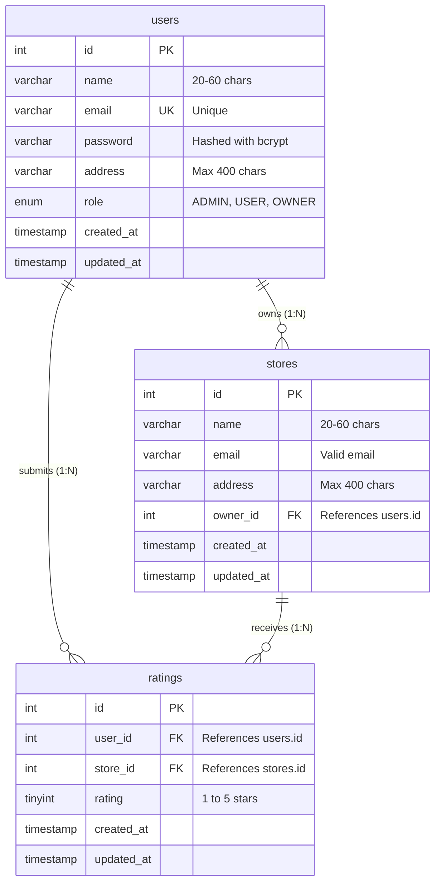

# Store Rating Management System - Database Documentation

This directory contains the database definition, seed datasets, and schema documentation for the **Store Rating Management System** (`store_rating_db`).

---

## 1. Database Overview

* **Engine**: MySQL 8.0+ (InnoDB)
* **Character Set**: `utf8mb4`
* **Collation**: `utf8mb4_unicode_ci`
* **Database Name**: `store_rating_db`

---

## 2. Entity Relationship Diagram (ERD)



---

## 3. Tables & Constraints

### A. `users` Table
Stores all authenticated accounts across all three roles.

| Column | Type | Constraints | Description |
| :--- | :--- | :--- | :--- |
| `id` | `INT` | `PRIMARY KEY, AUTO_INCREMENT` | Unique identifier for the user |
| `name` | `VARCHAR(60)` | `NOT NULL` | Full legal name (20–60 characters) |
| `email` | `VARCHAR(255)` | `NOT NULL, UNIQUE` | Unique email for authentication |
| `password` | `VARCHAR(255)` | `NOT NULL` | bcrypt password hash (Salt rounds = 10) |
| `address` | `VARCHAR(400)` | `NOT NULL` | Complete residential/office address |
| `role` | `ENUM` | `'ADMIN', 'USER', 'OWNER'` | Role-based access control level |
| `created_at` | `TIMESTAMP` | `DEFAULT CURRENT_TIMESTAMP` | Account creation timestamp |
| `updated_at` | `TIMESTAMP` | `ON UPDATE CURRENT_TIMESTAMP` | Last updated timestamp |

* **Indexes**:
  * `idx_users_role`: Speeds up filtering by role.
  * `idx_users_email`: Speeds up authentication lookups.
  * `idx_users_name`: Speeds up search queries by name.

---

### B. `stores` Table
Stores verified retail stores registered in Bangalore and assigns ownership.

| Column | Type | Constraints | Description |
| :--- | :--- | :--- | :--- |
| `id` | `INT` | `PRIMARY KEY, AUTO_INCREMENT` | Unique store identifier |
| `name` | `VARCHAR(60)` | `NOT NULL` | Official store name (20–60 characters) |
| `email` | `VARCHAR(255)` | `NOT NULL` | Store contact email |
| `address` | `VARCHAR(400)` | `NOT NULL` | Store physical address (Bangalore locality) |
| `owner_id` | `INT` | `NOT NULL, FK -> users(id)` | Store owner reference (`ON UPDATE CASCADE, ON DELETE RESTRICT`) |
| `created_at` | `TIMESTAMP` | `DEFAULT CURRENT_TIMESTAMP` | Store registration date |
| `updated_at` | `TIMESTAMP` | `ON UPDATE CURRENT_TIMESTAMP` | Last updated timestamp |

* **Indexes**:
  * `idx_stores_owner`: Rapid retrieval of a store owner's specific store.
  * `idx_stores_name`: Fast substring searches on store names.
  * `idx_stores_email`: Lookup stores by official email.

---

### C. `ratings` Table
Stores customer ratings submitted for stores.

| Column | Type | Constraints | Description |
| :--- | :--- | :--- | :--- |
| `id` | `INT` | `PRIMARY KEY, AUTO_INCREMENT` | Unique rating identifier |
| `user_id` | `INT` | `NOT NULL, FK -> users(id)` | User who submitted the rating (`ON DELETE CASCADE`) |
| `store_id` | `INT` | `NOT NULL, FK -> stores(id)` | Store being rated (`ON DELETE CASCADE`) |
| `rating` | `TINYINT` | `NOT NULL, CHECK (1..5)` | Rating score from 1 to 5 |
| `created_at` | `TIMESTAMP` | `DEFAULT CURRENT_TIMESTAMP` | Date rating was submitted |
| `updated_at` | `TIMESTAMP` | `ON UPDATE CURRENT_TIMESTAMP` | Date rating was modified |

* **Integrity Constraints**:
  * **Unique Rating Constraint**: `UNIQUE KEY unique_user_store_rating (user_id, store_id)` ensures that a single user can rate a given store exactly once. Subsequent submissions perform an `UPDATE`.
  * **Value Domain Check**: `CHECK (rating >= 1 AND rating <= 5)` prevents scores outside the 1–5 star range at the database layer.

---

## 4. How to Initialize the Database

### Option 1: Automated Node.js Script (Recommended)
From the project root:
```bash
npm run db:init
```
Or directly:
```bash
node database/initDb.js
```

### Option 2: MySQL Workbench
1. Open **MySQL Workbench**.
2. Connect to your local MySQL instance (`localhost:3306`).
3. Click **File -> Open SQL Script...** and select `database/schema.sql`.
4. Click the **Execute (Lightning icon)** button to create `store_rating_db` and all tables.
5. Open `database/seed.sql` and execute it to insert all sample Bangalore users, stores, and ratings.

### Option 3: MySQL Command Line (CLI)
```bash
mysql -u root -p < database/schema.sql
mysql -u root -p store_rating_db < database/seed.sql
```

---

## 5. Seed Dataset (Bangalore Edition)

### Default Accounts & Credentials

| Role | Name | Email | Password | Locality |
| :--- | :--- | :--- | :--- | :--- |
| **👑 ADMIN** | Prashant Choudhary Admin Head | `admin@bengalurustores.in` | `Admin@12345` | Residency Road, Ashok Nagar |
| **🏪 OWNER** | Rajesh Kumar Venkatachalam | `rajesh@koramangalatech.in` | `Owner@12345` | 4th Block, Koramangala |
| **🏪 OWNER** | Ananya Swaminathan Krishnan | `ananya@indiranagarorganic.in` | `Owner@12345` | Palm Meadows, Whitefield |
| **👤 USER** | Priyanka Radhakrishnan Iyer | `priyanka@bengaluruhub.in` | `User@12345` | Sobha Iris, Bellandur |
| **👤 USER** | Siddharth Ramesh Narayanan | `siddharth@bengaluruhub.in` | `User@12345` | 7th Sector, HSR Layout |
